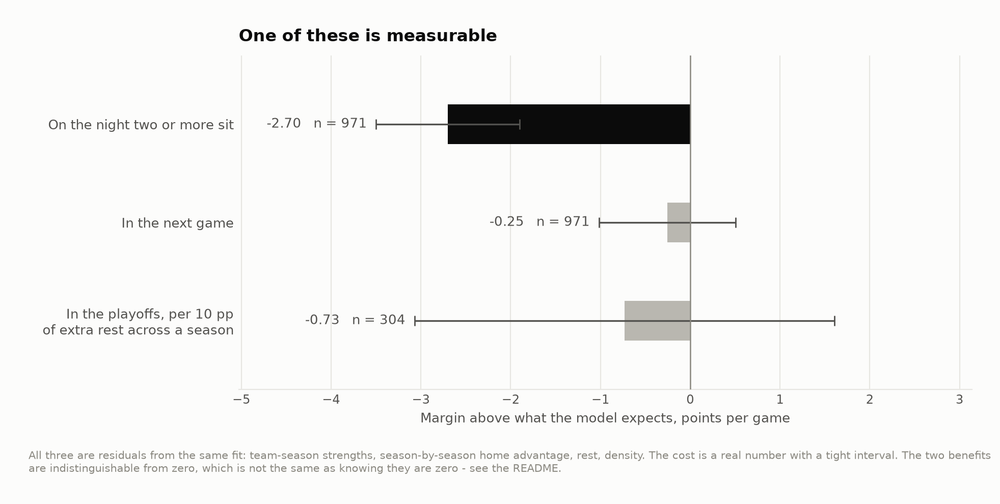
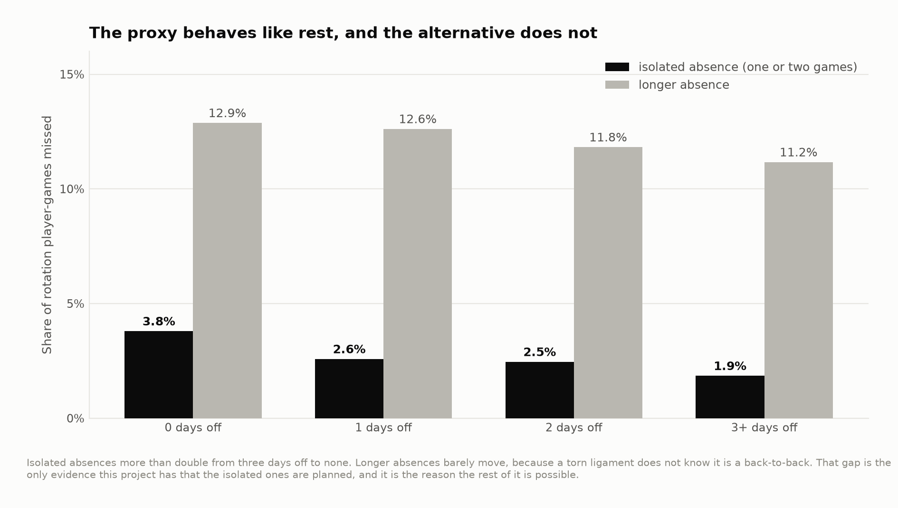

# Short absences among the Spurs' Big Three

What happened around short isolated player absences? Public box scores identify games missed, but usually do not establish why. This study uses one- or two-game absences bracketed by appearances in the same season as a descriptive proxy. It covers 2003–04 through 2022–23.

## Game-performance comparison

The outcome is margin relative to a fitted team-season and schedule baseline, in points per game. “Two or more sat” means the absence rule flagged multiple rotation players; it does not certify a healthy-rest decision.

| Split | Games | Margin vs expected | 95% lower | 95% upper |
|---|---|---|---|---|
| On a night two or more sat | 971 | -2.698 | -3.497 | -1.898 |
| The next game | 971 | -0.254 | -1.015 | 0.507 |
| Every other game | 46,036 | 0.053 | -0.054 | 0.161 |

Source: [ledger.csv](output/ledger.csv).

The next-game interval includes zero. That result does not show that rest has no benefit or demonstrate that the study had enough power to detect an operationally useful effect. The first and second groups overlap for some games.



## Playoff association

| Slope per 10 percentage points | Standard error | t statistic | Observations | Correlation |
|---|---|---|---|---|
| -0.732 | 1.192 | -0.614 | 304 | -0.035 |

Source: [playoff_fit.csv](output/playoff_fit.csv).

The slope is the difference in playoff scoring-margin overperformance per ten percentage points of the regular-season absence rate. Selection into rest, injuries and playoff qualification complicate interpretation. The small overall correlation does not prove a zero effect, and a stronger Spurs-only correlation is not sufficient evidence of a franchise-specific benefit.

## What the proxy captures

The rule flags known absences and is more common on back-to-backs, but minor injuries and illness can produce the same pattern. A known episode is a face-validity check, not a sensitivity/specificity study of the full sample. Medical records and verified absence reasons are unavailable.



## Front office implications

The analysis suggests questions for an availability study, not a rest prescription. A useful next step would distinguish planned rest from injury and measure later availability as well as game performance. The present observational comparison cannot estimate an optimal rest policy or its championship payoff.

## Reproduce

The historical analysis used Python 3.12 with the pinned dependencies below. From this repository:

```bash
python3.12 -m venv .venv
source .venv/bin/activate
python -m pip install -r requirements.txt
make fetch-data PY=python
make all PY=python
make report site PY=python
```

`make all` verifies source hashes before running the analyses in order. A missing or changed input stops the build. Data downloads need network access; article rendering uses the included result tables. See [the source manifest](data/source_manifest.json), [method notes](docs/method.md) and [current validation record](VALIDATION_CURRENT.md) for the distinction between a source rebuild and checks of delivered outputs.

Season keys in CSV files use the **ending year**: `2025` means 2024–25. Display tables use full season labels. The MIT license covers code; third-party data retain their providers' rights and terms.

[Portfolio](https://github.com/jmsmarrelli/basketball-analytics) · [AI assistance and provenance](PROVENANCE.md)
