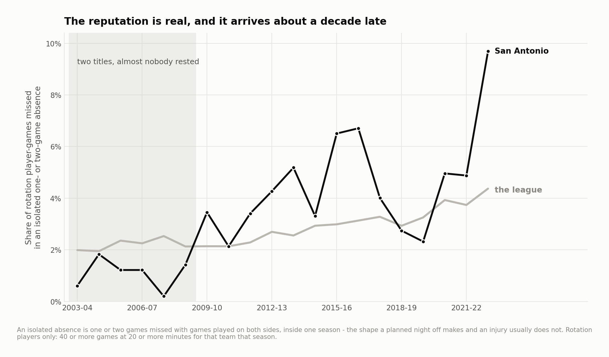
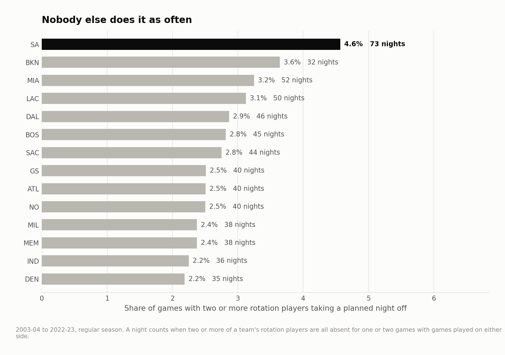
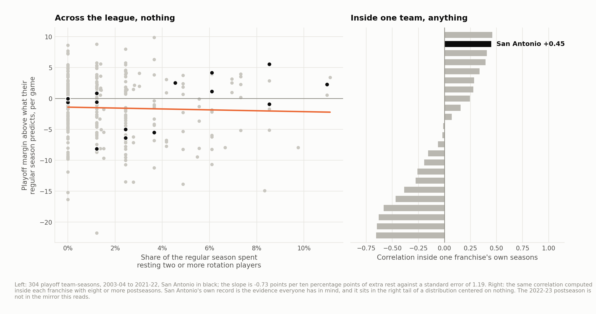

# What resting the Big Three actually bought

Gregg Popovich did not invent sitting healthy players, but his is the name most
attached to the league's rules about it. In November 2012 he sent Tim Duncan, Tony Parker,
Manu Ginóbili and Danny Green home from Miami before a nationally televised game
and the commissioner fined the franchise $250,000. The practice has a name now,
and it has a folklore: that resting was how the Spurs did it all along, and that
it bought their championships one night off at a time.

Twenty seasons of box scores, 23,934 games, 338,874 rotation-player game slots,
2003-04 to 2022-23.

**The reputation is real, and it starts later than the story says — after the
2005 and 2007 titles, not before them. What it cost is measurable. What it bought
is not.**

---

## The column that does not exist

The box score records that a player did not play. It does not record *why*. There
is no field for rest, injury, suspension or a newborn, and there never was.

So this project does not observe rest. It observes absences and splits them by
shape. **An absence of one or two games, with games played on both sides of it,
inside the same season** is the shape a planned night off makes. A torn ligament
does not make that shape.

That is the whole inference, and it is testable twice over. First, on the one
night everybody knows. The rule is given no dates, no names and no knowledge that
29 November 2012 exists:

| San Antonio, 29 November 2012 | | |
|---|---|---|
| Tim Duncan | did not play | **isolated, 1 game** |
| Tony Parker | did not play | **isolated, 1 game** |
| Manu Ginóbili | did not play | **isolated, 1 game** |
| Danny Green | did not play | **isolated, 1 game** |
| Kawhi Leonard | not on the active list | 18-game absence, not flagged |
| Boris Diaw, Tiago Splitter, Gary Neal | played | |

It finds the four players Popovich sent home and leaves out the one who was
actually hurt.

Second, and more usefully, on the whole sample:


| Days off before the game | Isolated absences | Longer absences |
|---|---|---|
| None (back-to-back) | **3.80%** | 12.88% |
| One | 2.58% | 12.62% |
| Two | 2.46% | 11.82% |
| Three or more | **1.85%** | 11.17% |

Isolated absences more than double from three days' rest to none, a gradient of
1.9 percentage points. Longer absences move by 1.7 points on a base five times
the size. The proxy tracks the thing a coach
schedules around; the alternative does not, because a knee does not know it is a
back-to-back.

Opponent strength barely matters either way — 2.98% against the weakest quarter
of opponents, 2.67% against the strongest — which is worth knowing, because
"they only did it against bad teams" is the first thing anyone says.

---

## When it actually started



Across the league the rate has doubled: 2.0% of rotation player-games lost to an
isolated absence in 2003-04, 4.4% in 2022-23.

San Antonio's own path is the surprise.

| | Planned nights off with two or more rested | League rank |
|---|---|---|
| 2003-04 to 2007-08 | **1** in five seasons | 10th to 20th |
| 2011-12 to 2016-17 | **36** in six seasons | 1st, 2nd, 1st, 5th, 1st, 1st |

**Through the 2005 and 2007 championships — the two the data can see — the Spurs
barely did this at all.** They sat below the league average in every one of their first six
seasons in the sample. The behavior everybody associates with those teams starts
around 2009-10, arrives properly in 2011-12, and peaks, for the Duncan era, in
2015-16 at nine nights — eleven per cent of the schedule — with Duncan at 39.

Over twenty seasons they still lead the league, and not narrowly:



**4.6% of their games, against 3.6% for Brooklyn over eleven seasons and 3.2% for
the next franchise present for all twenty.** Seventy-three nights with two or more rotation players sitting out, and the modern peak is
2022-23, a tanking season, which is a different thing wearing the same clothes.

---

## The ledger

Every number below is a residual from one fit: team-season strengths,
season-by-season home advantage, back-to-backs and schedule density, across all
23,934 games. R² 0.228, residual standard deviation 11.8 points.


| | Games | Margin above expectation |
|---|---|---|
| **On a night two or more sat** | 971 | **−2.70** (95%: −3.50 to −1.90) |
| The next game | 971 | −0.25 (−1.02 to +0.51) |
| Every other game | 46,036 | +0.05 |

Those first two groups overlap: 110 of the 971 "next games" were themselves rest
nights, because these teams sometimes sat people twice in a week. It pushes the
bounce estimate down slightly and it is not enough to make a null out of anything
that was not already one.

**The cost is real and it is about 2.7 points a game.** That is what
it looks like to play a game without two of your rotation.

**The bounce is not there.** The game after a planned night off is played to
expectation, not above it. Whatever the rest did, it did not show up the
following night.

---

## And April?

The version of the claim that actually matters is not about the next game. It is
that a season of managed minutes buys a fresher team in the playoffs.



Across 304 playoff team-seasons, the relationship between a team's regular-season
rest and how much better it played in the postseason than its regular season
predicted is **−0.73 points per ten percentage points of extra rest, against a
standard error of 1.19**. A correlation of −0.04. Nothing.

Here is the part worth sitting with. Inside San Antonio's own sixteen
postseasons, that correlation is **+0.45**. Their best over-performances (2013-14
at +5.5 a game, 2012-13 at +4.2) are exactly the seasons they rested most, and
their worst (2008-09 at −8.2, 2010-11 at −6.4) are seasons they barely rested at
all. If you had only the Spurs in front of you, you would believe the story.

Run the identical correlation inside every franchise with eight or more
postseasons and San Antonio ranks **2nd of 23** — behind Cleveland, ahead of
Milwaukee, with thirteen franchises negative and four of them below −0.55. The
distribution is centered on nothing and San Antonio sits in its right tail. That
is what a null looks like from inside the case that inspired the question.

---

## What I would not claim

That resting doesn't work. This data cannot show that, and three specific things
stop it.

**The teams that rest are not a random sample.** They rest because they are old,
or because the seed is already won. Team-season effects absorb the average of
that; they do not absorb *when* inside a season it happened.

**Availability in April is not measured here.** The mechanism everyone actually
means is "the star is on the floor in May instead of in a suit". A model of
playoff *margin* prices how well they played, not whether the best player was
available to play at all, and that is probably where the effect lives if it
exists.

**The interval is wide enough to matter.** The playoff slope runs from −3.1 to
+1.6 points a game. Either end of that is something a front office would care a
great deal about, and "not distinguishable from zero" is not "zero".

The honest summary is narrower than the headline and more useful than it: the
cost of a rest night is about 2.7 points and can be measured from twenty seasons
of box scores; the benefit, if it is there, is smaller than this instrument can
see.

---

## Running it

```bash
pip install -r requirements.txt
python src/run_01_build.py   # box scores -> the attendance panel and schedule
python src/run_02_rest.py    # validate the proxy, price the ledger, figures 01-05
```

Or `make all`. Under a minute.

```
src/
  config.py      paths, seasons, who counts as a rotation player
  rest.py        absences, their shape, and the schedule they sit in
  model.py       the margin model the ledger is measured against
  style.py       one place that decides what every figure looks like
  run_0*.py      the pipeline, in order
output/          every number quoted above, as CSV
figures/         five figures, regenerated from scratch by the pipeline
docs/method.md   longer notes, including what the proxy can and cannot bear
```

## Data

Player box scores from
[sportsdataverse/hoopR-data](https://github.com/sportsdataverse/hoopR-data), a
mirror of ESPN's public feeds. `data/README.md` has the fetch step and the
column that does not exist.

## License

MIT. See `LICENSE`.
